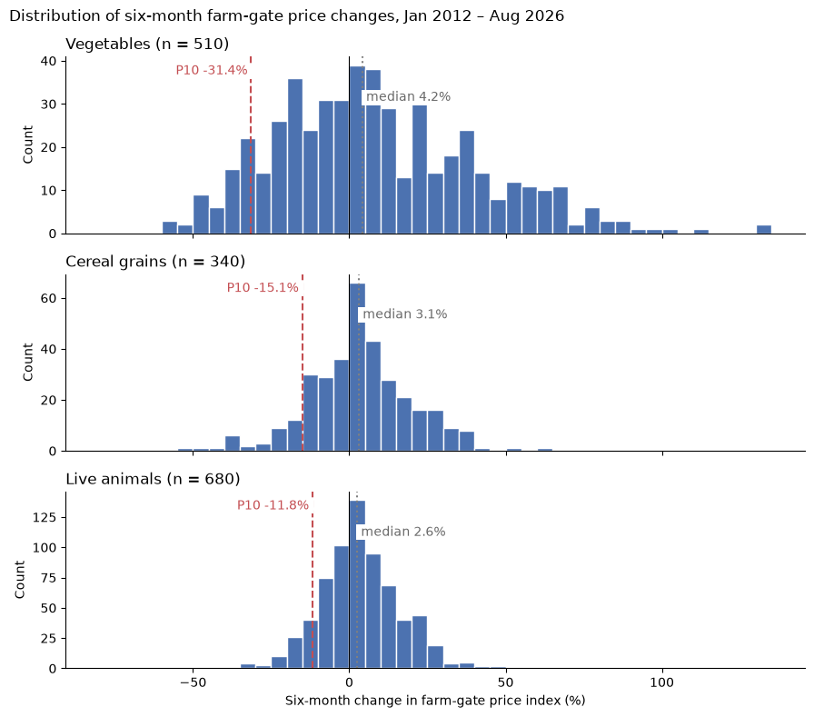

# Khula! Farm-Gate Price Risk Analysis

A data-quality review and descriptive analysis of StatsSA producer prices, measuring how far farm-gate prices fall in bad six-month periods and whether funders should use different repayment buffers for vegetables, cereal grains and live animals.

## The business question

[Khula!](https://www.khula.co.za/) is a South African agritech company that offers farmers a single application to several funders for production finance. This analysis assumes that the finance is repaid from the proceeds when the crops or animals are sold. Under that assumption, a fall in farm-gate prices between financing and sale puts repayment at risk.

The question: using StatsSA's monthly Producer Price Index (January 2012 to August 2026), what six-month percentage fall marks the worst 25%, 20%, 10% and 5% of six-month periods for vegetables (tomatoes, onions, potatoes), cereal grains (maize, wheat) and live animals (cattle, sheep, pigs, poultry)? And are the differences between the groups large enough to justify different repayment buffers?

## Data

StatsSA Producer Price Index, release P0142.1, *PPI Historicals Elementary Indices (202608)*. The file holds 277 product indices, monthly from January 2012 to August 2026 (176 months), all on a December 2023 = 100 base. 24 are agricultural products, and this analysis uses 9 of them. See [data/README.md](data/README.md) for the source link and file details.

The report reviews the data through six quality lenses:

| Lens | Finding |
|---|---|
| Coverage | Good for cereal grains and live animals (48.6% of the agriculture group's weight between them); limited for vegetables (three products, 8.9% of the weight). All series are national; there is no region column. |
| Completeness | All nine products have a value in every one of the 176 months. Some values may be imputed by StatsSA, and the file does not flag which. |
| Consistency | All series share one reference base. Dropping every change that uses a 2012 value (the agriculture PPI was introduced in January 2013) moves the bad-case falls by at most 1.6 percentage points and does not change the verdict. |
| Timeliness | Published within a month of the reference period. Timely enough for setting buffers, not for monitoring a running loan. |
| Representativeness | Prices come from markets, auctions and an association, not from farmers. A reasonable but imperfect stand-in for what Khula!'s farmers receive. |
| Interpretability | Usable once read with StatsSA's methods report. The file itself has no data dictionary, and values are index numbers, not rand prices. |

## Method

- **Product selection by rule, not by volatility.** Three StatsSA subgroups are used, and within each, every product of the right type with the full 176-month history: four live animals, three vegetables and two cereal grains. Together they carry 57.5% of the agricultural index weight.
- **Six-month percentage changes, not index levels.** Index levels mostly reflect long-run drift. On levels, tomatoes and maize look alike (standard deviation 24.8 vs 23.8), but their monthly changes are very different (19.0% vs 6.9%). Each product has 170 six-month changes.
- **Descriptive statistics** by group and product: mean, median, standard deviation, range, quartiles and skewness.
- **Outliers** flagged per product with the IQR rule (1.5 × IQR beyond the quartiles). They were investigated against the monthly index and kept, because they look like sustained real price moves rather than data errors.
- **Bad-case falls** measured as the 25th, 20th, 10th and 5th percentiles (P25, P20, P10, P5) of six-month changes.
- **Criterion for different buffers:**
  - (a) One group's fall is larger at all four levels.
  - (b) At each tested level, the ordering also holds at 3-, 6- and 12-month horizons, and across non-overlapping six-month windows.
  - A level is tested only if every group has at least 5 non-overlapping periods in its tail. That holds for P25, P20 and P10, so P5 is indicative only.
- **Sensitivity tests:** 3- and 12-month horizons, the six sets of non-overlapping windows, different minimum period counts, and a rerun without 2012.

## Key findings

Six-month changes in farm-gate price indices, January 2012 to August 2026 (nominal):

| Group | Mean | Median | Std dev | P25 | P20 | P10 | P5 (indicative) | Periods with a fall of 20% or more |
|---|---|---|---|---|---|---|---|---|
| Vegetables | 8.7% | 4.2% | 32.9% | −16.5% | −19.2% | −31.4% | −37.3% | 19.0% |
| Cereal grains | 3.5% | 3.1% | 16.5% | −6.8% | −8.7% | −15.1% | −23.4% | 6.8% |
| Live animals | 3.6% | 2.6% | 12.7% | −3.9% | −6.5% | −11.8% | −16.1% | 2.5% |



- **Average prices rose in every group, but falls are common.** Prices fell in 38.2% to 42.9% of six-month periods in every group. What differs between groups is the size of the falls.
- **Vegetables are right-skewed.** The mean (8.7%) is about double the median (4.2%), pulled up by a few very large rises (up to +132.9% for potatoes).
- **Outliers are mostly rises.** 22 of 1,530 six-month changes are outliers, and only two are falls: maize −50.5% (June 2017) and pigs −34.2% (May 2018).
- **The data supports two buffer tiers, not three.** Vegetables have a larger fall than both other groups at every level, and this passes the robustness test at P25, P20 and P10. Cereal grains vs live animals passes only at P20, so it is not justified. As a share of the expected selling price, P10 leaves 68.6% for vegetables and 86.7% for cereal grains and live animals combined.
- **Two warnings.**
  - At the indicative 5th percentile over 12 months, cereal grains fall further than vegetables (−35.7% vs −31.3%).
  - Maize's P10 fall (−23.4%) is closer to the vegetables' than to wheat's (−11.1%), so maize may need separate review.

## Limitations

- **Repayment assumption:** repayment from sale proceeds is an assumption. Khula!'s website does not say how its production finance is repaid.
- **Not Khula!'s farmers:** the PPI covers producers sampled by StatsSA, and its prices come from national markets, auctions and an association.
- **Nominal prices:** the index includes general inflation, so a farmer's real bad case is likely worse than shown.
- **Price risk only:** yields and costs are held constant.
- **Six-month horizon:** this is a scenario, not a known Khula! loan term.
- **Few independent periods:** there are only 56 to 116 non-overlapping six-month periods per group, and products in a group partly move together (average correlation 0.04 for vegetables, 0.28 for cereal grains, 0.23 for live animals). The percentiles are estimates, and P5 is indicative only.
- **Judgement choices:** the criterion, the four levels and the minimum of 5 periods are judgement choices.
- **Partial coverage:** only nine products are used (57.5% of the agricultural index weight), and vegetables are 8.9% of it.

## Case study: agricultural loan default prediction

The second part ([reports/agri_loan_default_case_study.pdf](reports/agri_loan_default_case_study.pdf)) analyses Wang, J. and Gu, M. (2026) ["Optimizing risk profiling of agricultural loans: default prediction using multi-source remote sensing digital footprints"](https://doi.org/10.3390/ijfs14070187), *International Journal of Financial Studies*, 14(7), 187.

- **What the paper does:** adds satellite and climate features to traditional borrower data to predict agricultural loan default, for pre-loan screening and in-loan monitoring.
- **Data:** 9,070 loan contracts from 8,221 farmers, family farms and cooperatives in Chongqing, China, 2016 to 2018. There are 418 defaults (4.61%) under the broad definition. Satellite and climate features come from the year before each loan.
- **Method:**
  - Logistic regression tests which variables are linked to default.
  - Eight machine learning models are compared, from a decision tree to boosting models and neural networks.
  - An Explainable Boosting Machine shows each feature's contribution.
- **Evaluation:**
  - The test split is 7:3, grouped by farmer, with ROC-AUC as the main measure.
  - Models on traditional features only scored 0.66 to 0.75. Adding remote sensing features raised AUC by about 0.11. Random forest rose from 0.733 to 0.865, with a sensitivity of 0.776 and specificity of 0.797.
  - In the test set, LightGBM flagged 634 loans, and 97 of them were defaults.
- **Reproducibility issues:**
  - The loan data is confidential.
  - Some addresses were geocoded by hand without a stated rule.
  - No code or final hyperparameters are published.
  - The default definition is described inconsistently.
- **Why it's relevant to Khula! (my reading, not from the paper):** the paper uses outside data to assess farmers who lack traditional credit records, which is the same problem Khula!'s Funder Dashboard addresses. Its false positives show the cost a creditworthy farmer could pay if a flag led to higher prices or smaller loans.

## How to run

You need Python 3.14.

```bash
git clone https://github.com/gopolangmmutlwane/khula-farm-gate-price-risk-analysis.git
cd khula-farm-gate-price-risk-analysis
python -m venv .venv
```

Activate the environment (`.venv\Scripts\activate` on Windows, `source .venv/bin/activate` on macOS/Linux), then:

```bash
pip install -r requirements.txt
```

Open `notebooks/farm_gate_price_risk.ipynb` in Jupyter or VS Code and run all cells. The data file is included in `data/`, and the notebook reads it from `../data/`.

## Repository layout

```
├── README.md
├── LICENSE
├── requirements.txt
├── data/
│   ├── README.md                                        source and file details
│   └── statssa_ppi_p0142_1_elementary_indices_202608.xlsx
├── images/six_month_change_distribution.png
├── notebooks/farm_gate_price_risk.ipynb
└── reports/
    ├── price_risk_data_quality_report.pdf / .docx       Part A report
    └── agri_loan_default_case_study.pdf / .docx         Part B case study
```

## Related work

- [khula-agritech-startup-analysis](https://github.com/gopolangmmutlwane/khula-agritech-startup-analysis): a profile and SWOT analysis of Khula! (first assessment in this module).
- [khula-maize-crop-health-computer-vision](https://github.com/gopolangmmutlwane/khula-maize-crop-health-computer-vision): a computer vision prototype that classifies maize leaf photos as healthy or diseased, as a crop-health signal for Khula!'s funders (second assessment).

## Licence

- The code and written work in this repository are licensed under the [MIT License](LICENSE).
- The data file remains the property of Statistics South Africa and is included with attribution: Source: Statistics South Africa. Users may apply or process this data, provided Statistics South Africa (Stats SA) is acknowledged as the original source of the data.
- The case-study paper by Wang and Gu (2026) is not included; it is linked above.

## Academic context

Submitted for the Data Science in Finance module (DSF182), assessment SS3, part of the Postgraduate Diploma in Data Science at STADIO Higher Education.

## Author

Gopolang Mmutlwane

- GitHub: [github.com/gopolangmmutlwane](https://github.com/gopolangmmutlwane)
- Portfolio: [gopolang-mmutlwane.onrender.com](https://gopolang-mmutlwane.onrender.com)
- LinkedIn: [linkedin.com/in/gopolang-mmutlwane-016250437](https://www.linkedin.com/in/gopolang-mmutlwane-016250437)
